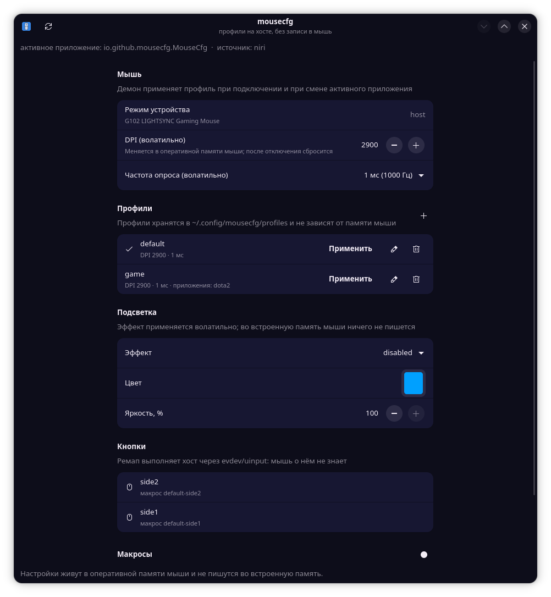

# mousecfg

[Русский](README.md) · **English**

[](https://www.gnu.org/licenses/gpl-3.0.html)
[](https://www.python.org/)
[](#)
[](#checks-that-nothing-is-written-to-flash)

Gaming mouse control on Linux where **profiles live on the host**, not in the
mouse memory.

The main requirement: when a profile is applied, nothing is written to the
mouse non-volatile memory (onboard memory / "flash"). All settings are sent as
volatile HID++ commands and are lost when the mouse is disconnected — the
daemon applies them again on reconnect.



## Features

- HID++ 2.0: DPI, report rate, device mode, name/firmware (Logitech);
- mice without HID++ (e.g. AJAZZ 2.4G): per-application profiles, button
  remapping and macros through evdev; DPI, report rate and lighting are set on
  the mouse itself. See what was found and what is available with `mousecfg list`;
- the YJX vendor channel (AJAZZ 2.4G) is **read-only**: `mousecfg vendor`
  shows the identification and the raw replies of the read commands and writes
  nothing;
- a `systemd --user` daemon: it finds the mouse, applies a profile on connect
  and switches profiles based on the focused application;
- TOML profiles: DPI, report rate, buttons, macros, matching by serial number
  or application;
- button remapping and macros via evdev/uinput — on the host side, the mouse
  knows nothing about them;
- a GTK4/libadwaita app as a thin client of the daemon;
- a journal of every command sent and a feature allow-list;
- a CLI.

What the project **never** does: write onboard profiles, reset the device,
enable hidden features or update firmware. This is forbidden in
`hidpp/guard.py` and enforced by tests.

The only persistent operation is a one-time `On-Board → Host` switch
(`0x8100/0x10`). It is performed only with `--allow-onboard-switch`, because
without Host mode the host settings do not apply at all. Consent is remembered
(per device): if the firmware returns the mouse to On-Board after a reboot, the
daemon repeats the switch on its own. You can disable this with the daemon
option `--no-auto-host`.

## Installation

### Quick install with one command

If you do not want to deal with the details, there is `install.sh` which does
everything itself:

```sh
git clone https://github.com/derekvlad/mousecfg
cd mousecfg
./install.sh
```

What the script does, step by step:

1. installs system dependencies (GTK4/libadwaita, Python-GObject, evdev) via
   your package manager (pacman/apt/dnf/zypper);
2. creates a `.venv` with `--system-site-packages` and installs the package
   from this directory;
3. installs udev rules (it will ask for the `sudo` password — otherwise the
   daemon cannot access the mouse);
4. places a menu entry, a tray icon, the systemd unit and symlinks for the
   `mousecfg*` commands into `~/.local/bin`;
5. enables and starts the daemon.

Options:

```sh
./install.sh --dry-run    # only show what would be done
./install.sh --no-deps    # do not touch system packages
./install.sh --no-udev    # skip installing udev rules
./install.sh --no-start   # install but do not enable the daemon
./install.sh --uninstall  # remove the user part (udev rules must be removed manually)
```

The script is idempotent: running it again breaks nothing. If something went
wrong or you prefer a manual installation, the section below describes the same
steps separately.

### Manual installation

The project uses PyGObject/GTK, which on most distributions are provided by the
system and are not built inside a regular venv. That is why the environment is
created with `--system-site-packages` — then `gi`/GTK are visible from the venv.

```sh
cd mousecfg
python3 -m venv --system-site-packages .venv
.venv/bin/pip install -e ".[dev,input]"
```

After that the commands appear in `.venv/bin/`:

```sh
.venv/bin/mousecfg --version
.venv/bin/mousecfg list
.venv/bin/mousecfg-gui          # GUI
.venv/bin/mousecfg-daemon -v    # daemon in the foreground
```

If you run it without installing, `PYTHONPATH=src python3 -m mousecfg …` works
too.

Installing the user part (application menu, icon, systemd unit, command
symlinks in `~/.local/bin`):

```sh
sh scripts/install-user.sh
```

The script requires nothing from root: everything goes into the home directory.
It also substitutes the absolute path to `mousecfg-daemon` into the systemd
unit and to `mousecfg-tray` into autostart — so the repository can live
anywhere and the tray autostart works correctly. After it, mousecfg appears in
the application menu and starts as `mousecfg-gui`.

Runtime dependencies:

```sh
# Debian/Ubuntu
sudo apt install python3-gi gir1.2-gtk-4.0 gir1.2-adw-1   # GUI
sudo apt install python3-evdev                            # buttons and macros
# Arch
sudo pacman -S python-gobject gtk4 libadwaita python-evdev
```

Device and input access:

```sh
sudo install -m 0644 data/60-mousecfg.rules /etc/udev/rules.d/
sudo install -m 0644 data/70-mousecfg-input.rules /etc/udev/rules.d/
sudo install -m 0644 data/71-mousecfg-virtual.rules /etc/udev/rules.d/
sudo udevadm control --reload
sudo udevadm trigger --subsystem-match=hidraw
sudo udevadm trigger --subsystem-match=input
```

The first rule grants an ACL on the mouse HID++ node (hidraw), the second on
`/dev/input/event*` for button remapping, the third on the virtual device
`mousecfg virtual input`, through which events are relayed. The daemon does not
need root: it runs in the user session.

Mice without HID++ (see `mousecfg list`) do not need hidraw access at all: the
second and third rules are enough — profiles, buttons and macros work through
evdev/uinput.

Check that the ACL appeared:

```sh
getfacl /dev/input/event*   # the mouse node must have user:<you>:rw-
mousecfg inputs             # the mouse and its buttons must be visible
```

If the ACL does not include your user (and `mousecfg inputs` says "no
permissions"), the rule did not fire. A common cause is the condition
`ACTION=="add"` instead of `ACTION!="remove"`: on systemd ≥ v258 the ACL is
applied by `systemd-udevd` on `change` events, so the rule must match on
`change` as well. In this repository all rules are already like that; if you
installed an earlier version, reinstall the rules and restart udev:

```sh
sudo install -m 0644 data/70-mousecfg-input.rules /etc/udev/rules.d/
sudo udevadm control --reload && sudo udevadm trigger --subsystem-match=input
```

Daemon autostart (easier via `sh scripts/install-user.sh`, it substitutes the
path itself; the manual version is below):

```sh
mkdir -p ~/.config/systemd/user
cp data/mousecfg-daemon.service ~/.config/systemd/user/
systemctl --user daemon-reload
systemctl --user enable --now mousecfg-daemon
```

When copying manually, the unit keeps the default path
`%h/mousecfg/.venv/bin/mousecfg-daemon` (`%h` is the home directory). If the
repository is elsewhere or you installed the package differently, fix
`ExecStart`: `systemd --user` does not inherit `PATH` from the shell profile, so
the path must be absolute. `scripts/install-user.sh` performs this substitution
automatically.

Checks and management:

```sh
systemctl --user status mousecfg-daemon
journalctl --user -u mousecfg-daemon -f
systemctl --user restart mousecfg-daemon
```

The unit is bound to `graphical-session.target`: the daemon starts together with
the graphical session and restarts if it crashes. The daemon only needs ACLs on
hidraw/uinput — root is not required.

## Usage

```sh
mousecfg list                 # find mice and their protocol
mousecfg judge                # policy: what is allowed, what is denied
mousecfg get                  # name, firmware, DPI, report rate, mode
mousecfg set-dpi 1600         # volatile
mousecfg set-rate 1000Hz      # volatile
mousecfg lighting             # lighting zones and effects
mousecfg lighting --effect static --color '#00a0ff' --brightness 60
mousecfg mode host --allow-onboard-switch   # one-time switch to Host mode
mousecfg profiles-check       # validate TOML profiles
mousecfg vendor               # the mouse vendor channel: read-only
mousecfg vendor --probe       # raw replies of the read commands (no writes)

mousecfg status               # daemon state
mousecfg devices              # devices managed by the daemon
mousecfg inputs               # mouse evdev nodes (for button remapping)
mousecfg profile activate game # select a profile manually (it is pinned)
mousecfg profile next         # switch to the next profile (for a shortcut)
mousecfg daemon -v            # run the daemon in the foreground
mousecfg run-profile examples/g102-buttons.toml   # remap without the daemon
```

### Profiles and macros without editing TOML by hand

`profile` and `macro` change the same profiles file. If the daemon is running,
the change goes through it: the file is re-read and the profile is applied
immediately. The file cannot be corrupted — before writing, the result is parsed
and a reference to a non-existent macro is rejected.

```sh
# create a profile (--button and --match-app can be repeated)
mousecfg profile add --id fps --name "Shooters" --dpi 800 --rate 1000Hz \
    --button side1=browser-back --button side2=macro:burst \
    --match-app cs2 --match-app "steam_app_*"

mousecfg profile set --id fps --dpi 1600        # change an existing one
mousecfg profile show fps                       # show it (--json for machine output)
mousecfg profile show                           # all profiles in the file
mousecfg profile remove fps

# macros: steps are 'ctrl+c', 'wait:120' (pause), 'tap:enter:50' (key + pause)
mousecfg macro add --id burst --name "Burst" --interval-ms 40 \
    --step "ctrl+c" --step "wait:120" --step "tap:enter:50"
mousecfg macro add --id burst --step "tap:x" --replace   # replace
mousecfg macro list                             # list the macros in the file
```

A button action is given as `BUTTON=ACTION`, where ACTION is an action name
(`browser-back`, `copy`, `ignore`), `macro:name` or `key:ctrl+c`. You can point
to the file explicitly with `--profile-file PATH` (no running daemon needed).

Selecting a profile manually (`profile activate`, a shortcut, the tray, the GUI)
**pins** it: the daemon keeps it when the focused window changes and does not
fall back to the first profile in the file. A profile with `match_apps` still
wins over the manual choice — when its application opens, it is applied, and
when you leave the application the daemon returns the pinned profile.

### Lighting

Lighting changes volatilely: the effect lives in the mouse RAM and resets on
disconnect, just like DPI and report rate. The command only reads and changes
runtime state — nothing is written to onboard memory (persistent NvConfig writes
are forbidden by the policy).

Before writing an effect, the daemon takes lighting control away from the
firmware (`setSwControl`, volatile): without it the firmware keeps drawing the
onboard profile colour and writing the effect looks like "nothing happens".

```sh
mousecfg lighting                          # which zones and effects the mouse knows
mousecfg lighting --effect breathe --color '#00ff88' --brightness 70 --period 4000
mousecfg lighting --effect disabled        # turn lighting off
```

Lighting can be part of a profile — then it is applied together with it:

```sh
mousecfg profile add --id glow --dpi 1600 \
    --lighting-effect static --lighting-color blue --lighting-brightness 40
```

```toml
[[profile]]
id = "glow"
dpi = 1600
[profile.lighting]
effect = "breathe"
color = "#00ff88"
brightness = 70
period = 4000
```

### Tray and profile-switching shortcut

`mousecfg-tray` is a small GTK3 + AppIndicator3 process: it shows the current
profile and lets you switch profiles, enable or disable button remapping and
open the main window. The tray runs separately from the GUI because
AppIndicator3 is built on GTK3 while the window is GTK4.

The same process also holds global profile-switching shortcuts. On desktops
with a working `org.freedesktop.portal.GlobalShortcuts` portal (GNOME, KDE)
the tray enters the scope `app-io.github.mousecfg.MouseCfg-tray.scope` itself
via `systemd-run` (the portal derives the app id only from the systemd unit
name), and on first launch the portal shows a dialog to assign the combinations
and remembers them afterwards. You can disable this with `--no-shortcuts`.

On niri and other wlroots compositors there is no `GlobalShortcuts` portal: the
tray detects this, does not touch the portal and therefore does not spawn stuck
"Add Keyboard Shortcuts" windows. In that case the compositor binds the shortcut
itself — mousecfg prints a ready-made block and can append it to the config:

```sh
mousecfg keybinds              # show the binds block for niri
mousecfg keybinds --install    # append to ~/.config/niri/config.kdl (with a backup)
niri msg action load-config-file
```

By default these are `Alt+Shift+Right` (next profile) and `Alt+Shift+Left`
(previous); the combinations are ordinary niri binds and can be changed in the
config.

```sh
mousecfg-tray                 # tray icon (+ portal shortcuts where available)
mousecfg-tray --no-shortcuts  # tray only, no portal
```

The tray is installed into `~/.config/autostart` and starts automatically when
you log into the graphical session (`systemd-xdg-autostart-generator`). An
important detail: this generator silently skips a `.desktop` file if the
executable from `Exec=` is not found in the systemd manager's `PATH`, and
`~/.local/bin` is not part of it. That is why the installer substitutes the
absolute path to `mousecfg-tray` into `Exec=`; if you installed the tray
manually and the icon is missing, check:

```sh
ls ~/.config/autostart/io.github.mousecfg.MouseCfg-tray.desktop
systemctl --user status 'app-io.github.mousecfg.MouseCfg\x2dtray@autostart.service'
```

### Example profiles file

An example profile (`~/.config/mousecfg/profiles/<model>.toml`):

```toml
version = 1

[[device]]
id = "logitech-g102-lightsync"
serials = ["205C35585247"]

[[profile]]
id = "default"
name = "Regular use"
dpi = 1600
report_rate = "1000Hz"

[[profile]]
id = "shooter"
name = "Shooters"
dpi = 800
match_apps = ["cs2", "steam_app_*"]

[[profile]]
id = "desktop"
dpi = 1600
[profile.buttons]
"side1" = "browser-back"
"side2" = { macro = "burst" }

[[macro]]
id = "burst"
interval_ms = 30
steps = [
    { tap = "ctrl+c", delay_ms = 50 },
    { wait = true, delay_ms = 120 },
]
```

`storage = "onboard"` in a profile is rejected with an error: the project keeps
profiles on the host only.

## GUI

```sh
source .venv/bin/activate    # or PYTHONPATH=src
mousecfg-gui                 # or python3 -m mousecfg.gui.app
```

The app shows the device mode, the current DPI and report rate, the profile list
with an "Apply" button, button bindings and macros. All changes go to the daemon
over a UNIX socket: the GUI does not talk to the mouse directly.

Profiles can be created, edited and deleted right in the window: the "+" button
in the header of the "Profiles" group and the "pencil"/"trash" buttons in a
profile row. The profile dialog sets the id, name, DPI, report rate, application
matching (`match_apps`), button bindings in the form
`side1=copy, side2=macro:burst` and the profile lighting (effect, colour,
brightness). As in the CLI, writing without validation is not allowed: a
reference to a non-existent macro is rejected and the profiles file stays
intact.

The "Lighting" group in the main window appears for mice that support it and
changes the effect volatilely.

A macro is recorded in two steps so it is clear which button it is bound to. The
profile dialog has a "Button and macro" group: first choose the mouse button
(`side1` is the rear side button, often called `button4`/Back; `side2` is the
front side button, `button5`/Forward), then press "Record macro" and press the
keys you need. The macro is saved with an id like `profile-button` and is
immediately substituted into that button's bindings — you do not have to type
`macro:` by hand. Recording happens in the window itself, so it requires
neither `/dev/input` permissions nor the `input` group.

Keys are recognised by **keycode**, not by symbol: recording does not depend on
the layout (Cyrillic is recorded the same way as Latin) or on Shift — `Shift+1`
produces the step `shift+1`, not the symbol `!`. "Record" captures key presses,
"Stop" ends them.

A separate "Macros" group in the main window shows all macros of the profile and
lets you re-record or delete them. The "Record" button in its header opens
recording for a macro "from scratch" — it is not bound to a button; bind it with
a bindings string.

## Checks that nothing is written to flash

```sh
# from the project journal: no persistent frames must remain after the command
python3 scripts/capture-hid.py -- python3 -m mousecfg set-dpi 1600

# volatility: the values must reset after a physical reconnect
python3 scripts/replug-test.py

# self-test of button remapping and macros (needs /dev/uinput and /dev/input access)
PYTHONPATH=src python3 scripts/evdev-selftest.py
```

`evdev-selftest.py` raises a virtual mouse, runs movement, bound and unbound
buttons and a macro through the remapper — and checks that everything reached
the virtual output. A real mouse is not needed for this.

## Documentation

- [`docs/en/device-matrix.md`](docs/en/device-matrix.md) — what has been tested on real hardware;
- [`docs/en/architecture.md`](docs/en/architecture.md) — the layers and why they are like that;
- [`docs/en/licensing.md`](docs/en/licensing.md) — licences and code provenance.

## Development

```sh
git clone https://github.com/derekvlad/mousecfg
cd mousecfg
python3 -m venv --system-site-packages .venv
.venv/bin/pip install -e ".[dev,input]"

# tests (only the sources are needed; GUI tests are skipped without a display)
PYTHONPATH=src .venv/bin/python -m pytest

# linter
.venv/bin/ruff check src tests scripts
```

Project rules:

- **nothing is written to onboard memory.** Any command that touches
  non-volatile memory is rejected in `hidpp/guard.py`; the tests
  `tests/test_guard.py` and `tests/test_safeplane.py` guard this.
- Profiles, macros and lighting are data on the host plus volatile HID++
  commands.
- No third-party code is copied: the protocol is derived from public
  documentation and behaviour; see `docs/en/licensing.md` for details.

Useful scripts:

```sh
python3 scripts/capture-hid.py -- python3 -m mousecfg set-dpi 1600   # frame journal
python3 scripts/replug-test.py                                      # volatility check
PYTHONPATH=src python3 scripts/evdev-selftest.py                    # remap without a real mouse
```

## Licence

GPL-3.0-or-later. The HID++ 2.0 protocol was derived from public documentation
and from the behaviour of the Solaar installation present on the system (used
"as a reference manual"); no third-party code is copied into the project, see
`docs/en/licensing.md`.

---

Interface language is chosen by `MOUSECFG_LANG` → `LC_ALL` → `LC_MESSAGES` →
`LANG`; supported values are `ru` and `en`, Russian is the default. You can also
force it per command: `MOUSECFG_LANG=en mousecfg --help`.

The daemon is a separate process: its messages (for example, button
descriptions in `mousecfg status`) come from the daemon environment. To switch
those too, set the language in the user systemd manager:

```sh
systemctl --user set-environment MOUSECFG_LANG=en
systemctl --user restart mousecfg-daemon
```
