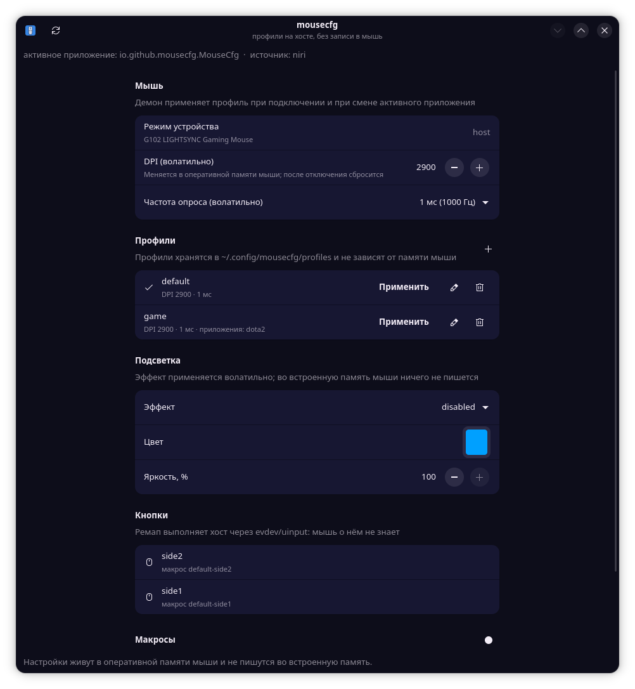

# mousecfg

**Русский** · [English](README.en.md)

[](https://www.gnu.org/licenses/gpl-3.0.html)
[](https://www.python.org/)
[](#)
[](#проверки-во-флеш-ничего-не-пишется)

Управление игровыми мышами в Linux, где **профили живут на хосте**, а не в памяти мыши.

Главное требование: при применении профиля в энергонезависимую память мыши
(onboard memory / «флеш») не пишется ничего. Все настройки передаются
волатильными HID++ командами и теряются при отключении мыши — демон
применяет их заново при подключении.

Исключение — явная команда `mousecfg onboard`: если пользователь сам решил
записать настройки в память мыши (например, чтобы они жили без демона),
проект сначала сохраняет **снимок** текущего состояния, показывает
предупреждение и только потом пишет. Профили демона памяти не касаются
никогда.



## Возможности

- HID++ 2.0: DPI, report rate, режим устройства, имя/прошивка (Logitech);
- мыши без HID++ (например, AJAZZ 2.4G): профили по приложениям, ремап кнопок
  и макросы через evdev; DPI, частота и подсветка у них задаются самой мышью.
  Что нашлось и что доступно — `mousecfg list`;
- вендорский канал YJX (AJAZZ 2.4G): по умолчанию **только чтение** —
  `mousecfg vendor` показывает модель, даты прошивки, DPI, частоту и заряд;
  `get` добавляет их к карточке мыши, заряд виден в трее и в окне;
- отдельные команды `mousecfg onboard` пишут настройки в память мыши
  (DPI, частота, подсветка и т. д.) — только с флагом `--allow-onboard-write`,
  с предупреждением при первом подключении и **обязательным снимком** до
  каждой записи (`onboard backup`/`restore`);
- демон `systemd --user`: сам находит мышь, применяет профиль при подключении
  и переключает его по активному приложению;
- профили в TOML: DPI, частота опроса, кнопки, макросы, привязка к серийнику
  или приложению;
- ремап кнопок и макросы через evdev/uinput — на стороне хоста, мышь о них
  не знает;
- GTK4/libadwaita-приложение как тонкий клиент демона: группа «Память мыши»
  (для мышей с вендорским каналом) умеет записать DPI в саму мышь — после
  предупреждения и со снимком до записи;
- журнал каждой отправленной команды и белый список фич;
- CLI.

Чего проект не делает **никогда**: записи onboard-профилей демоном, сброса
устройства, включения скрытых фич и прошивки. Запрещено в `hidpp/guard.py` и
проверяется тестами. Единственное исключение — ручные команды
`mousecfg onboard`, и только с `--allow-onboard-write`.

Единственная персистентная операция — однократный переход
`On-Board → Host` (`0x8100/0x10`). Он выполняется только с
`--allow-onboard-switch`, потому что без Host mode настройки с хоста
вообще не применяются. Согласие запоминается (по устройству): если прошивка
после перезагрузки снова вернёт мышь в On-Board, демон повторит переход сам.
Отключить это можно ключом демона `--no-auto-host`.

## Установка

### Быстрая установка одной командой

Если не хочется разбираться с деталями — есть `install.sh`, который делает всё
сам:

```sh
git clone https://github.com/derekvlad/mousecfg
cd mousecfg
./install.sh
```

Скрипт по шагам:

1. ставит системные зависимости (GTK4/libadwaita, Python-GObject, evdev)
   через ваш менеджер пакетов (pacman/apt/dnf/zypper);
2. создаёт `.venv` с `--system-site-packages` и ставит пакет из этого каталога;
3. ставит правила udev (спросит пароль `sudo` — иначе демон не получит доступ
   к мыши);
4. раскладывает значок в меню, иконку трея, systemd-юнит и симлинки команд
   `mousecfg*` в `~/.local/bin`;
5. включает и запускает демон.

Ключи:

```sh
./install.sh --dry-run    # только показать, что будет сделано
./install.sh --no-deps    # не трогать системные пакеты
./install.sh --no-udev    # пропустить установку правил udev
./install.sh --no-start   # установить, но не включать демон
./install.sh --uninstall  # удалить пользовательскую часть (udev-правила — вручную)
```

Скрипт идемпотентен: повторный запуск ничего не ломает. Если что-то пошло не
так или вы предпочитаете ручную установку — раздел ниже описывает те же шаги
по отдельности.

### Установка вручную

Проект использует PyGObject/GTK, которые в большинстве дистрибутивов
поставляются системно и не собираются в обычном venv. Поэтому окружение
создаётся с `--system-site-packages` — тогда `gi`/GTK видны из venv.

```sh
cd mousecfg
python3 -m venv --system-site-packages .venv
.venv/bin/pip install -e ".[dev,input]"
```

После этого команды появляются в `.venv/bin/`:

```sh
.venv/bin/mousecfg --version
.venv/bin/mousecfg list
.venv/bin/mousecfg-gui          # GUI
.venv/bin/mousecfg-daemon -v    # демон на переднем плане
```

Если запускаете без установки, работает и `PYTHONPATH=src python3 -m mousecfg …`.

Установка пользовательской части (меню приложений, иконка, systemd-юнит,
симлинки команд в `~/.local/bin`):

```sh
sh scripts/install-user.sh
```

Скрипт ничего не требует от root: всё кладётся в домашний каталог. Он же
подставляет абсолютный путь к `mousecfg-daemon` в systemd-юнит и к
`mousecfg-tray` в autostart — поэтому репозиторий можно держать где угодно, и
корректно работает автозапуск трея. После него mousecfg появляется в меню
приложений и запускается как `mousecfg-gui`.

Зависимости на время работы:

```sh
# Debian/Ubuntu
sudo apt install python3-gi gir1.2-gtk-4.0 gir1.2-adw-1   # GUI
sudo apt install python3-evdev                            # кнопки и макросы
# Arch
sudo pacman -S python-gobject gtk4 libadwaita python-evdev
```

Доступ к устройству и ввод:

```sh
sudo install -m 0644 data/60-mousecfg.rules /etc/udev/rules.d/
sudo install -m 0644 data/70-mousecfg-input.rules /etc/udev/rules.d/
sudo install -m 0644 data/71-mousecfg-virtual.rules /etc/udev/rules.d/
sudo udevadm control --reload
sudo udevadm trigger --subsystem-match=hidraw
sudo udevadm trigger --subsystem-match=input
```

Первое правило даёт ACL на HID++ узел мыши (hidraw), второе — на
`/dev/input/event*` для ремапа кнопок, третье — на виртуальное устройство
`mousecfg virtual input`, через которое ретранслируются события. Root демону
не нужен: он работает
в пользовательской сессии.

Мышам без HID++ (см. `mousecfg list`) hidraw-доступ не нужен вовсе: им
достаточно второго и третьего правил — профили, кнопки и макросы работают
через evdev/uinput.

Проверить, что ACL появился:

```sh
getfacl /dev/input/event*   # у узла мыши должен быть user:<вы>:rw-
mousecfg inputs             # должны быть видны мышь и её кнопки
```

Если в ACL нет вашего пользователя (и `mousecfg inputs` пишет «нет прав»),
правило не сработало. Частая причина — условие `ACTION=="add"` вместо
`ACTION!="remove"`: на systemd ≥ v258 ACL навешивает `systemd-udevd` по
`change`-событиям, поэтому правило обязано совпадать и на `change`. В этом
репозитории все правила уже такие; если вы ставили более раннюю версию,
переустановите правила и перезапустите udev:

```sh
sudo install -m 0644 data/70-mousecfg-input.rules /etc/udev/rules.d/
sudo udevadm control --reload && sudo udevadm trigger --subsystem-match=input
```

Автозапуск демона (проще — через `sh scripts/install-user.sh`, он подставит
путь сам; ниже — вручную):

```sh
mkdir -p ~/.config/systemd/user
cp data/mousecfg-daemon.service ~/.config/systemd/user/
systemctl --user daemon-reload
systemctl --user enable --now mousecfg-daemon
```

При ручном копировании в юните останется путь по умолчанию
`%h/mousecfg/.venv/bin/mousecfg-daemon` (`%h` — домашний каталог). Если
репозиторий лежит в другом месте или вы ставили пакет иначе, поправьте
`ExecStart`: `systemd --user` не наследует `PATH` из профиля shell, поэтому
путь должен быть абсолютным. `scripts/install-user.sh` делает эту подстановку
автоматически.

Проверка и управление:

```sh
systemctl --user status mousecfg-daemon
journalctl --user -u mousecfg-daemon -f
systemctl --user restart mousecfg-daemon
```

Юнит привязан к `graphical-session.target`: демон стартует вместе с
графической сессией и перезапускается при падении. Демону нужны только
ACL на hidraw/uinput — root не требуется.

## Использование

```sh
mousecfg list                 # найти мыши и их протокол
mousecfg judge                # политика: что разрешено, что запрещено
mousecfg get                  # имя, прошивка, DPI, report rate, режим
mousecfg set-dpi 1600         # волатильно
mousecfg set-rate 1000Hz      # волатильно
mousecfg lighting             # зоны и эффекты подсветки
mousecfg lighting --effect static --color '#00a0ff' --brightness 60
mousecfg mode host --allow-onboard-switch   # однократный переход в Host mode
mousecfg profiles-check       # проверить TOML-профили
mousecfg vendor               # вендорский канал мыши: только чтение
mousecfg vendor --probe       # сырые ответы читающих команд (без записи)

mousecfg onboard show         # текущие настройки в памяти мыши (чтение)
mousecfg onboard backup       # снимок конфигурации в ~/.config/mousecfg/backups
mousecfg onboard apply --dpi 1600 --rate 1000Hz --allow-onboard-write
mousecfg onboard restore --allow-onboard-write   # вернуть последний снимок

mousecfg status               # состояние демона
mousecfg devices              # устройства под управлением демона
mousecfg inputs               # evdev-узлы мышей (для ремапа кнопок)
mousecfg profile activate game # выбрать профиль вручную (закрепляется)
mousecfg profile next         # переключить на следующий профиль (для хоткея)
mousecfg daemon -v            # запустить демон на переднем плане
mousecfg run-profile examples/g102-buttons.toml   # ремап без демона
```

### Язык интерфейса

CLI, GUI, трей и сообщения демона говорят по-русски и по-английски. Язык
выбирается по `MOUSECFG_LANG`, затем `LC_ALL`, `LC_MESSAGES`, `LANG`;
поддерживаются `ru` и `en`, по умолчанию — русский. Можно переопределить для
одной команды:

```sh
MOUSECFG_LANG=en mousecfg --help
MOUSECFG_LANG=en mousecfg-gui
```

Демон — отдельный процесс: его сообщения (например, описания кнопок в
`mousecfg status`) берутся из окружения демона. Чтобы переключить и их, задайте
язык в пользовательском systemd:

```sh
systemctl --user set-environment MOUSECFG_LANG=en
systemctl --user restart mousecfg-daemon
```

### Профили и макросы без правки TOML вручную

`profile` и `macro` меняют тот же файл профилей. Если демон запущен, правка
идёт через него: файл перечитывается и профиль применяется сразу. Файл нельзя
испортить — перед записью результат разбирается парсером, а ссылка на
несуществующий макрос отклоняется.

```sh
# создать профиль (можно повторять --button и --match-app)
mousecfg profile add --id fps --name "Шутеры" --dpi 800 --rate 1000Hz \
    --button side1=browser-back --button side2=macro:burst \
    --match-app cs2 --match-app "steam_app_*"

mousecfg profile set --id fps --dpi 1600        # изменить существующий
mousecfg profile show fps                       # показать (--json для машинного вывода)
mousecfg profile show                           # все профили файла
mousecfg profile remove fps

# макросы: шаги — 'ctrl+c', 'wait:120' (пауза), 'tap:enter:50' (клавиша + пауза)
mousecfg macro add --id burst --name "Серия" --interval-ms 40 \
    --step "ctrl+c" --step "wait:120" --step "tap:enter:50"
mousecfg macro add --id burst --step "tap:x" --replace   # заменить
mousecfg macro list                             # список макросов файла
```

Действие кнопки задаётся как `BUTTON=ACTION`, где ACTION — имя действия
(`browser-back`, `copy`, `ignore`), `macro:имя` или `key:ctrl+c`. Файл можно
указать явно через `--profile-file ПУТЬ` (не нужен запущенный демон).

Выбор профиля вручную (`profile activate`, хоткей, трей, GUI) **закрепляется**:
демон удерживает его при смене активного окна и не сбрасывает на первый профиль
файла. Профиль с `match_apps` по-прежнему важнее ручного выбора — когда
открывается его приложение, применяется он, а при уходе из приложения демон
возвращает закреплённый профиль.

### Подсветка

Подсветка меняется волатильно: эффект живёт в оперативной памяти мыши и
сбрасывается при отключении, как и DPI с частотой опроса. Команда только
читает и меняет рантайм-состояние — во встроенную память мыши не пишется
ничего (персистентная запись NvConfig запрещена политикой).

Перед записью эффекта демон забирает управление подсветкой у прошивки
(`setSwControl`, волатильно): без этого прошивка продолжает рисовать цвет
onboard-профиля и запись эффекта выглядит как «ничего не происходит».

```sh
mousecfg lighting                          # какие зоны и эффекты знает мышь
mousecfg lighting --effect breathe --color '#00ff88' --brightness 70 --period 4000
mousecfg lighting --effect disabled        # выключить подсветку
```

Подсветку можно включить в профиль — тогда она применяется вместе с ним:

```sh
mousecfg profile add --id glow --dpi 1600 \
    --lighting-effect static --lighting-color blue --lighting-brightness 40
```

```toml
[[profile]]
id = "glow"
dpi = 1600
[profile.lighting]
effect = "breathe"
color = "#00ff88"
brightness = 70
period = 4000
```

### Трей и хоткей смены профиля

`mousecfg-tray` — небольшой процесс GTK3 + AppIndicator3: он показывает
текущий профиль и даёт переключить профиль, включить или выключить ремап
кнопок и открыть главное окно. Трей запускается отдельно от GUI, потому что
AppIndicator3 построен на GTK3, а окно — на GTK4.

Тот же процесс умеет держать глобальные хоткеи смены профиля. На рабочих
столах с рабочим порталом `org.freedesktop.portal.GlobalShortcuts` (GNOME,
KDE) трей сам заходит в scope `app-io.github.mousecfg.MouseCfg-tray.scope`
через `systemd-run` (портал выдаёт app id только по имени systemd-юнита), а
при первом запуске портал показывает диалог для назначения комбинаций и потом
их помнит. Отключить это можно ключом `--no-shortcuts`.

На niri и других wlroots-композиторах портала `GlobalShortcuts` нет: трей это
распознаёт, не трогает портал и потому не плодит зависшие окна «Add Keyboard
Shortcuts». Хоткей в этом случае вешает сам композитор — mousecfg печатает
готовый блок и умеет дописать его в конфиг:

```sh
mousecfg keybinds              # показать блок binds для niri
mousecfg keybinds --install    # дописать в ~/.config/niri/config.kdl (с бэкапом)
niri msg action load-config-file
```

По умолчанию это `Alt+Shift+Right` (следующий профиль) и `Alt+Shift+Left`
(предыдущий); комбинации — обычные bind'ы niri, их можно поменять в конфиге.

```sh
mousecfg-tray                 # иконка в трее (+ хоткеи портала там, где он есть)
mousecfg-tray --no-shortcuts  # только трей, без портала
```

Трей ставится в `~/.config/autostart` и поднимается автоматически при входе в
графическую сессию (`systemd-xdg-autostart-generator`). Важная деталь: этот
генератор молча пропускает `.desktop`, если исполняемый файл из `Exec=` не
найден в `PATH` менеджера systemd, а `~/.local/bin` туда не входит. Поэтому
установщик подставляет в `Exec=` абсолютный путь к `mousecfg-tray`; если вы
ставили трей вручную и иконки нет — проверьте:

```sh
ls ~/.config/autostart/io.github.mousecfg.MouseCfg-tray.desktop
systemctl --user status 'app-io.github.mousecfg.MouseCfg\x2dtray@autostart.service'
```

### Пример файла профилей

Пример профиля (`~/.config/mousecfg/profiles/<модель>.toml`):

```toml
version = 1

[[device]]
id = "logitech-g102-lightsync"
serials = ["205C35585247"]

[[profile]]
id = "default"
name = "Обычная работа"
dpi = 1600
report_rate = "1000Hz"

[[profile]]
id = "shooter"
name = "Шутеры"
dpi = 800
match_apps = ["cs2", "steam_app_*"]

[[profile]]
id = "desktop"
dpi = 1600
[profile.buttons]
"side1" = "browser-back"
"side2" = { macro = "burst" }

[[macro]]
id = "burst"
interval_ms = 30
steps = [
    { tap = "ctrl+c", delay_ms = 50 },
    { wait = true, delay_ms = 120 },
]
```

`storage = "onboard"` в профиле отвергается с ошибкой: проект хранит профили
только на хосте.

## Интерфейс GUI

```sh
source .venv/bin/activate    # или PYTHONPATH=src
mousecfg-gui                 # либо python3 -m mousecfg.gui.app
```

Приложение показывает режим устройства, текущие DPI и частоту опроса,
список профилей с кнопкой «Применить», назначения кнопок и макросы. Все
изменения уходят демону через UNIX-сокет: GUI не общается с мышью напрямую.

Профили можно создавать, редактировать и удалять прямо в окне: кнопка «+» в
заголовке группы «Профили» и кнопки «карандаш»/«корзина» в строке профиля.
Диалог профиля задаёт id, имя, DPI, частоту опроса, привязку к приложениям
(`match_apps`), назначения кнопок в виде `side1=copy, side2=macro:burst` и
подсветку профиля (эффект, цвет, яркость). Как и в CLI, запись без проверки
не проходит: ссылка на несуществующий макрос отклоняется, файл профилей
остаётся целым.

Группа «Подсветка» в главном окне появляется у мышей, которые её поддерживают,
и меняет эффект волатильно.

Макрос пишется в два шага, чтобы было понятно, к какой кнопке он привязан.
В диалоге профиля есть группа «Кнопка и макрос»: сначала выберите кнопку мыши
(`side1` — задняя боковая, её часто зовут `button4`/Back; `side2` — передняя
боковая, `button5`/Forward), затем нажмите «Записать макрос» и нажмите нужные
клавиши. Макрос сохраняется с id вида `профиль-кнопка` и сразу подставляется в
назначения этой кнопки — вручную вписывать `macro:` не нужно. Запись ведётся в
самом окне, поэтому не требует ни прав на `/dev/input`, ни группы `input`.

Клавиши распознаются по **keycode**, а не по символу: запись не зависит от
раскладки (кириллица пишется так же, как латиница) и от Shift — `Shift+1`
даёт шаг `shift+1`, а не символ `!`. «Записать» ловит нажатия, «Остановить»
их прекращает.

Отдельная группа «Макросы» в главном окне показывает все макросы профиля и
даёт их перезаписать или удалить. Кнопка «Записать» в её заголовке открывает
запись для макроса «с нуля» — он не привязан к кнопке, привяжите его строкой
назначений.

## Проверки «во флеш ничего не пишется»

```sh
# по журналу проекта: после команды не должно остаться персистентных кадров
python3 scripts/capture-hid.py -- python3 -m mousecfg set-dpi 1600

# волатильность: значения должны сброситься после физического переподключения
python3 scripts/replug-test.py

# самопроверка ремапа кнопок и макросов (нужны права на /dev/uinput и /dev/input)
PYTHONPATH=src python3 scripts/evdev-selftest.py
```

`evdev-selftest.py` поднимает виртуальную мышь, прогоняет через ремап
движение, привязанные и непривязанные кнопки и макрос — и проверяет, что
всё дошло до виртуального выхода. Реальная мышь для этого не нужна.

## Документация

- `docs/device-matrix.md` — что проверено на реальном железе;
- `docs/architecture.md` — слои и почему так;
- `docs/onboard.md` — запись в память мыши: команды, безопасность, восстановление;
- `docs/licensing.md` — лицензии и происхождение кода;
- `docs/en/*.md` — те же документы на английском (и `README.en.md`).

## Разработка

```sh
git clone https://github.com/derekvlad/mousecfg
cd mousecfg
python3 -m venv --system-site-packages .venv
.venv/bin/pip install -e ".[dev,input]"

# тесты (нужны только исходники; графические тесты пропускаются без дисплея)
PYTHONPATH=src .venv/bin/python -m pytest

# линтер
.venv/bin/ruff check src tests scripts
```

Правила проекта:

- **ничего не пишется во встроенную память мыши.** Любая команда, попадающая
  в энергонезависимую память, отклоняется в `hidpp/guard.py`; тесты
  `tests/test_guard.py` и `tests/test_safeplane.py` это стерегут.
- Профили, макросы и подсветка — данные на хосте и волатильные HID++-команды.
- Чужой код не копируется: протокол разбирается по публичной документации и по
  поведению; подробнее — `docs/licensing.md`.

Полезные скрипты:

```sh
python3 scripts/capture-hid.py -- python3 -m mousecfg set-dpi 1600   # журнал кадров
python3 scripts/replug-test.py                                      # проверка волатильности
PYTHONPATH=src python3 scripts/evdev-selftest.py                    # ремап без реальной мыши
```

## Лицензия

GPL-3.0-or-later. Протокол HID++ 2.0 разбирался по публичной документации
и по поведению имеющегося на системе Solaar (в режиме «чтение справки»);
чужой код в проект не копируется, см. `docs/licensing.md`.
